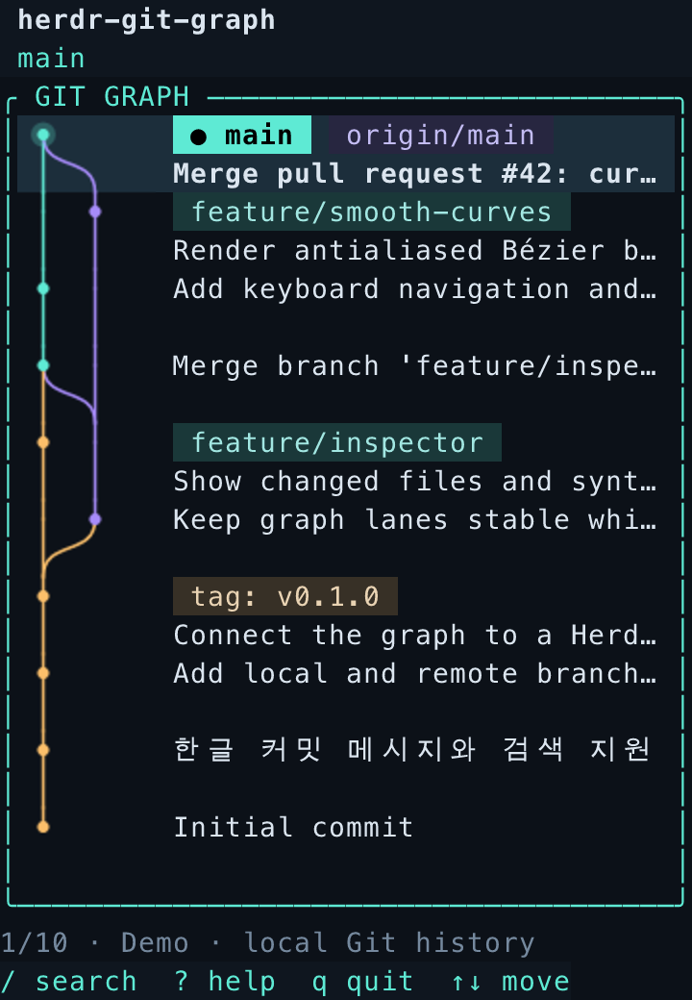
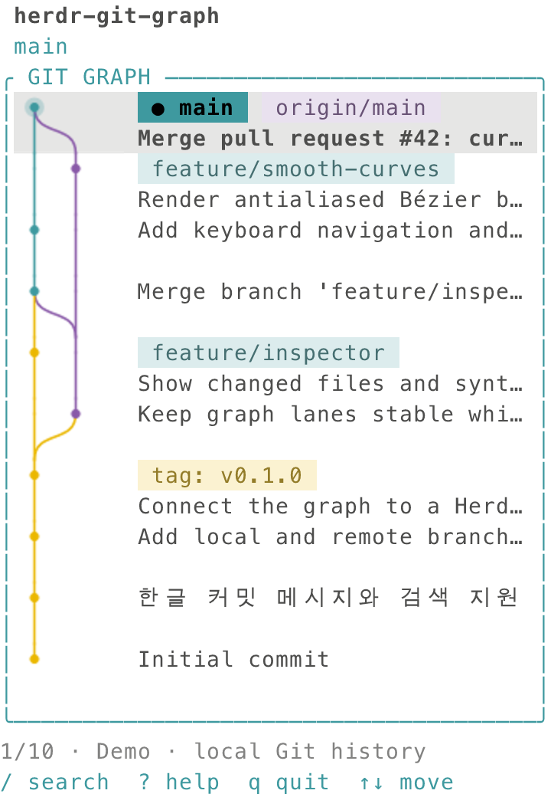
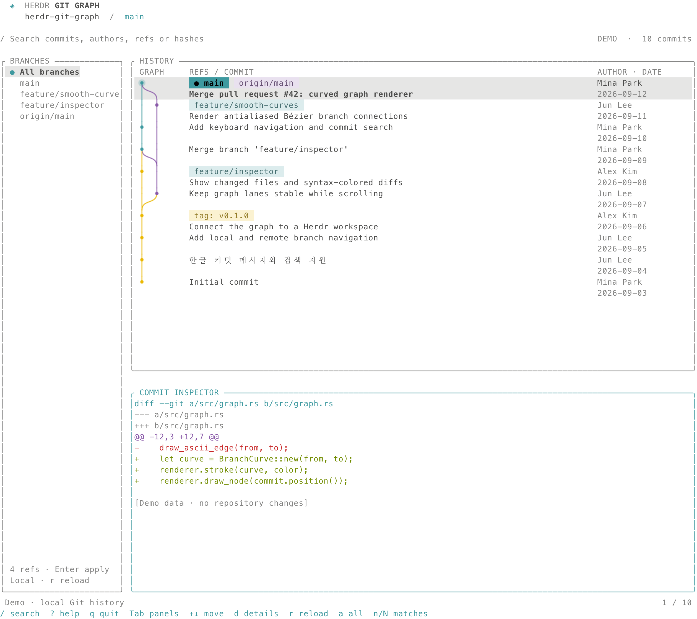

# Herdr Git Graph

**코드 옆에 Git 이력을 두고, 커밋을 펼쳐 변경 파일을 확인하세요.**

[](https://github.com/sjlee06/herdr-git-graph/actions/workflows/ci.yml)
[](LICENSE)
[](https://herdr.dev/docs/plugins/)

[English](README.md) · 한국어

Herdr용 조회 전용 Git 그래프 플러그인입니다. 사이드바에서 이력을 살펴보고 커밋 바로 아래에 변경 파일 목록을 펼칠 수 있습니다. 전체 화면에서는 브랜치 필터와 diff를 사용할 수 있습니다.

<table>
  <tr>
    <th width="50%">어두운 테마 · Classic</th>
    <th width="50%">밝은 테마 · Tomorrow</th>
  </tr>
  <tr>
    <td><a href="docs/preview-sidebar-dark.png"></a></td>
    <td><a href="docs/preview-sidebar-light.png"></a></td>
  </tr>
</table>

*같은 사이드바 데모를 어두운 테마와 밝은 테마로 비교했습니다. 이미지를 누르면 크게 볼 수 있습니다.*

[Herdr 편집기 옆에 배치한 사이드바](docs/preview-sidebar.png)도 확인할 수 있습니다(데모 합성 이미지). 기본 `--theme auto`는 사용 중인 터미널 색상을 따릅니다.

## 주요 기능

- **작업 공간 공유 사이드바:** 포커스를 가져오지 않고 활성 탭을 따라 이동하며 현재 조회 상태 유지.
- **브랜치·병합 그래프:** 분기별 색상과 현재 브랜치·로컬 브랜치·원격 브랜치·태그를 구분하는 배지.
- **변경 파일:** 그래프를 유지한 채 커밋 아래에 파일 상태와 경로 표시.
- **Diff 보기:** 사이드바에서 파일을 클릭해 해당 파일의 diff 확인. 전체 화면에서는 커밋 전체 diff 확인.
- **검색:** 메시지·작성자·ref·해시로 커밋 검색.
- **자동 갱신:** 기본 2초 간격으로 로컬 변경 반영.
- **터미널 연동:** 터미널 테마를 자동 적용하고, Herdr 0.9.0+ 호환 패널에서는 표준 Kitty graphics protocol로 곡선을, 그 외에는 문자 그래프를 표시.

커밋 목록에서는 제목 위에 브랜치·태그 배지를 표시합니다. 현재 브랜치는 `●`, 원격 브랜치는 보라색 계열 배지로 구분하며, 공간이 부족하면 나머지 배지 수를 `+N`으로 표시합니다. 커밋 해시는 목록에서 숨기고 전체 화면의 상세 패널에서 전체 ref 이름과 함께 보여줍니다. 해시 검색은 그대로 사용할 수 있습니다.

## 그래픽 렌더러

부드러운 곡선은 Herdr graphics socket API를 거치지 않고 graph pane의 PTY에 직접 기록하는 표준 Kitty graphics PNG입니다. 터미널 셀에 맞춰 배치되며, 텍스트와 대화상자는 곡선 위에 유지되고 resize·도움말·종료 시에는 이 플러그인의 이미지만 정리합니다.

곡선은 Kitty graphics가 켜진 Herdr 0.9.0+와 호환되는 바깥 터미널이 필요합니다. 사용할 수 없으면 플러그인이 자동으로 색상 Unicode 그래프로 전환하며, `--renderer text`로 언제나 문자 그래프를 선택할 수 있습니다. renderer와 theme 설정은 [상세 사용 안내](docs/USAGE.md#renderers)를 참고하세요.

## 설치

**Herdr 0.9.0 이상**, **Git 2.31 이상**, `curl`이 필요합니다. **Rust나 Cargo는 설치하지 않아도 됩니다.**

배포 실행 파일은 **macOS 11 이상**, **glibc 2.35 이상인 Linux**(예: Ubuntu 22.04 이상)의 Apple Silicon/ARM64 및 x86_64를 지원합니다. 다른 환경에서는 [소스 빌드 안내](docs/DEVELOPMENT.md)를 참고하세요.

```bash
herdr plugin install sjlee06/herdr-git-graph
```

Git 저장소가 열려 있는 Herdr 작업 공간에서 현재 패널 오른쪽에 사이드바를 엽니다.

```bash
herdr plugin action invoke herdr.git-graph.sidebar
```

이 액션은 작업 공간마다 하나의 사이드바를 재사용합니다. 다른 탭에 있다면 액션을 실행한 탭으로 옮기며, 이후 탭을 전환할 때도 포커스를 가져오지 않고 따라옵니다. 같은 프로세스가 계속 실행되므로 선택한 커밋, 스크롤 위치, 검색, 테마가 유지됩니다. 사용자가 조절한 너비도 기억해 공간이 허용하는 범위에서 복원하며, 다른 작업 공간은 별도의 사이드바를 사용합니다.

분할선을 드래그하거나 `prefix+r`로 크기를 바꾸세요. `prefix+l`로 사이드바에 이동한 뒤 `q`로 닫을 수 있습니다. 패널을 직접 닫아도 공유가 끝나며, 사이드바 액션을 다시 실행해야 열립니다. 사이드바가 있는 탭을 닫으면 같은 작업 공간에 다른 탭이 남아 있을 때 사이드바가 다시 열립니다. 원래 저장소와 테마, 선택한 커밋, 스크롤 위치, 검색, 조절한 너비가 복원됩니다. 너비 제한과 공유하지 않는 실행 방법은 [상세 사용 안내](docs/USAGE.md#graph-only-sidebar)를 참고하세요.

### 전체 화면

<table>
  <tr>
    <th width="50%">어두운 테마 · Classic</th>
    <th width="50%">밝은 테마 · Tomorrow</th>
  </tr>
  <tr>
    <td><a href="docs/preview.png"></a></td>
    <td><a href="docs/preview-light.png"></a></td>
  </tr>
</table>

*브랜치를 필터링하고 커밋 diff를 확인하는 전체 화면 데모입니다.*

브랜치 필터와 분할된 diff 상세 패널을 사용하려면 새 탭으로 전체 그래프를 엽니다.

```bash
herdr plugin action invoke herdr.git-graph.open
```

### 단축키 연결

`~/.config/herdr/config.toml`에 사용하지 않는 키를 등록합니다.

```toml
[[keys.command]]
key = "prefix+u"
type = "plugin_action"
command = "herdr.git-graph.toggle-sidebar"
description = "Toggle Git Graph Sidebar"

[[keys.command]]
key = "prefix+shift+u"
type = "plugin_action"
command = "herdr.git-graph.open"
description = "Open Git Graph in New Tab"
```

`herdr config check`로 충돌을 확인하고 `herdr server reload-config`를 실행하세요. 설정한 prefix 다음 `Shift+u`는 새 탭에 전체 그래프를 엽니다. `u`는 사이드바가 없으면 열고, 이미 열려 있으면 닫습니다. 이렇게 닫으면 마지막으로 조절한 너비를 기억하고, 다시 열기 전까지 탭을 전환해도 사이드바가 따라오지 않습니다. 다시 열 때는 공간이 허용하는 범위에서 저장된 너비를 복원합니다. 기존 `herdr.git-graph.sidebar` 액션은 열린 사이드바를 재사용하는 열기 전용 액션으로 유지됩니다.

## 사용법

기본적으로 사이드바는 커밋을 선택하지 않은 상태로 시작합니다. 커밋 노드나 행을 클릭하면 해당 커밋이 선택되고 바로 아래에 변경 파일의 상태와 경로가 펼쳐집니다. 그래프는 그대로 유지됩니다. 같은 커밋을 다시 클릭하거나 **Esc**를 누르면 목록이 접히고 선택이 해제됩니다. **↑** / **↓**는 커밋을 선택하며 목록을 펼치고, **Enter**는 목록을 펼치거나 접습니다. 휠은 선택을 바꾸지 않고 이력과 긴 파일 목록을 자유롭게 스크롤하며, 오른쪽 스크롤바로 현재 위치를 확인할 수 있습니다.

파일을 클릭하면 사이드바 안에서 해당 파일의 diff가 열립니다. **Esc**를 누르면 펼쳐둔 목록으로 돌아갑니다. 키보드로는 **Tab**으로 파일 목록에 포커스를 옮긴 뒤 **↑** / **↓**로 파일을 선택하고 **Enter**로 diff를 엽니다. Diff는 휠이나 **↑** / **↓**로 스크롤하고 **h** / **l**로 가로 이동합니다.

전체 화면에서 브랜치를 선택하고 **Enter**를 누르면 해당 이력만 표시하며, **a**를 누르면 전체 브랜치로 돌아갑니다. 커밋이나 **Uncommitted changes**를 선택하면 아래 상세 패널에서 diff를 확인할 수 있습니다.

| 키 | 동작 |
| --- | --- |
| `Tab` / `Shift-Tab` | 사이드바에서 커밋 / 파일 탐색 전환; 전체 화면에서 패널 전환 |
| `↑` `↓` / `j` `k` | 커밋·파일 이동 또는 diff 스크롤 |
| `Enter` | 검색 적용; 사이드바에서 파일 목록 펼치기 / 접기 또는 선택한 파일 열기; 전체 화면에서 브랜치 필터 적용 / 상세 패널 이동 |
| `h` / `l` | diff 가로 스크롤, 이력에서는 그래프 가로 이동 |
| `Esc` | 파일 diff에서 목록으로 돌아가기; 사이드바 목록 접기·선택 해제; 검색 초기화 / 도움말 닫기 |
| `/`, `n` / `N` | 검색, 다음 / 이전 검색 결과 |
| `a` | 전체 브랜치 보기 |
| `r` | 파일 diff 또는 로컬 이력 새로고침 |
| `?` | 도움말 열기 / 닫기 |
| `q` / `Ctrl-C` | 종료 (`q`는 도움말부터 닫기) |

전체 화면에서는 마우스 클릭으로 항목을 선택합니다. 휠은 포인터 아래 패널을 스크롤합니다. 사이드바의 파일 diff는 스테이징·미스테이징 변경을 나눠 표시하며, 추적하지 않는 텍스트 파일은 읽기 전용으로 내용을 보여줍니다.

로컬 Git 데이터를 조회하므로 원격의 새 커밋은 기존 Git 작업 흐름에서 fetch한 뒤 확인할 수 있습니다. 검색은 불러온 이력을 대상으로 하며, **기본 2,000개 커밋**을 `--limit`으로 조정할 수 있습니다.

전체 단축키, 저장소 지정, 테마 설정, 문제 해결은 [상세 사용 안내](docs/USAGE.md)를 참고하세요. [Herdr 없이 실행](docs/USAGE.md#run-without-herdr)할 수도 있습니다.

## 개발 및 기여

빌드, 테스트, 기여 방법은 [개발 안내](docs/DEVELOPMENT.md)를 참고하세요. 버그 제보에는 OS, Herdr 버전, 터미널 종류, 재현 방법을 함께 적어주세요.

## 라이선스

[MIT](LICENSE). [Herdr](https://herdr.dev/)용 독립 커뮤니티 플러그인입니다.
