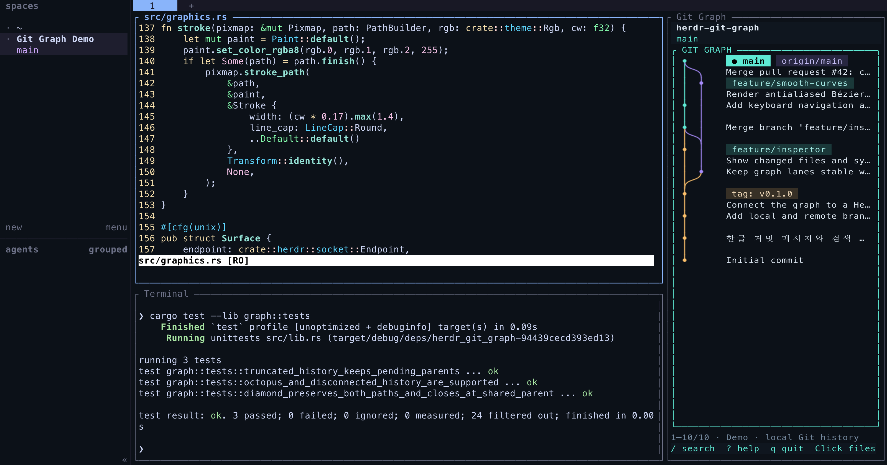
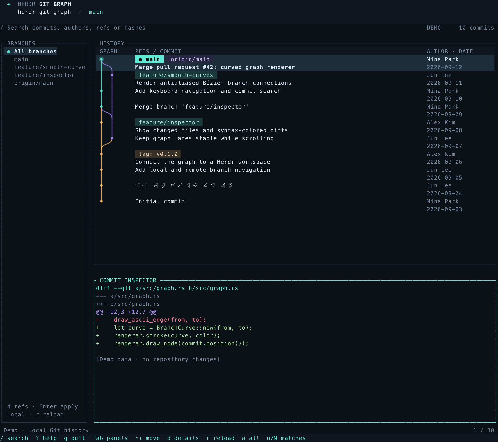

# Herdr Git Graph

**Keep Git history beside your code. Open the full view to inspect a diff.**

[](https://github.com/sjlee06/herdr-git-graph/actions/workflows/ci.yml)
[](LICENSE)
[](https://herdr.dev/docs/plugins/)

English · [한국어](README.ko.md)

A read-only Git graph plugin for Herdr, with a sidebar for browsing history and a full view for inspecting changes.

<p align="center">
  
</p>

*Browse Git history beside your code. Demo shown.*

## Features

- **Workspace-shared sidebar** — one sidebar follows the active tab without taking focus, keeping its view state.
- **Branch and merge graph** — colored lanes with branch and tag labels.
- **Diffs** — inspect commits and staged or unstaged changes in the full view.
- **Search** — find commits by message, author, ref, or hash.
- **Live updates** — local changes appear automatically, checked every 2 seconds by default.
- **Terminal integration** — follows your terminal theme, drawing smooth curves with the standard Kitty graphics protocol in Herdr 0.9.2+ panes and using a text graph otherwise.

## Graphics renderer

Smooth curves are standard Kitty graphics PNGs written directly to the graph pane's PTY; no Herdr graphics socket API is used. The graph stays aligned in terminal cells, keeps text and dialogs above the curves, and removes its own image on resize, help, or exit.

Curves need Herdr 0.9.2+ with Kitty graphics enabled and a compatible outer terminal. The plugin automatically falls back to the colored Unicode graph when that path is unavailable; `--renderer text` always selects it. See the [usage guide](docs/USAGE.md#renderers) for renderer and theme options.

## Install

Requires **Herdr 0.9.5+**, **Git 2.31+**, and `curl`. **Rust and Cargo are not required.**

Prebuilt releases support **macOS 11+** and **Linux with glibc 2.35+** (for example, Ubuntu 22.04+), on Apple Silicon/ARM64 and x86_64. For other systems, see [source builds](docs/DEVELOPMENT.md).

```bash
herdr plugin install sjlee06/herdr-git-graph
```

From a Herdr workspace containing a Git repository, open the sidebar beside your current pane:

```bash
herdr plugin action invoke herdr.git-graph.sidebar
```

The action reuses one sidebar per workspace. If it is on another tab, it moves to the tab you invoked the action from; subsequent tab switches bring it along without taking focus. The same process keeps the selected commit, scroll position, search, and theme. Your chosen width is remembered and restored where space allows, and other workspaces have their own sidebar.

Drag the divider or use `prefix+r` to resize the sidebar. Use `prefix+l` to focus it, then `q` to close. Closing the pane also ends sharing; only another sidebar action opens it again. Closing its containing tab instead recreates the sidebar if another tab remains in the same workspace, restoring its original repository, theme, selected commit, scroll position, search, and chosen width. See the [usage guide](docs/USAGE.md#graph-only-sidebar) for sizing limits and unshared sidebar launches.

### Full view



*Filter branches and inspect commit diffs. Demo shown.*

Open the full graph in a new tab to filter branches and inspect changes:

```bash
herdr plugin action invoke herdr.git-graph.open
```

### Add a keybinding

Add an available key to `~/.config/herdr/config.toml`:

```toml
[[keys.command]]
key = "prefix+u"
type = "plugin_action"
command = "herdr.git-graph.open"
description = "Open Git Graph"

[[keys.command]]
key = "prefix+shift+u"
type = "plugin_action"
command = "herdr.git-graph.toggle-sidebar"
description = "Toggle Git Graph Sidebar"
```

Run `herdr config check`, then `herdr server reload-config`. Press your prefix followed by `u` for the full view or `Shift+u` to toggle the sidebar: open it when closed, or close it when already open. Closing this way also stops tab-following until the next open. The `herdr.git-graph.sidebar` action remains open-only and reuses an existing sidebar.

## Use

In the full view, select a branch and press **Enter** to filter its history; press **a** to show all branches again. Select a commit or **Uncommitted changes** to inspect its diff below.

| Key | Action |
| --- | --- |
| `Tab` / `Shift-Tab` | Switch panels in the full view |
| `↑` `↓` / `j` `k` | Navigate items or scroll the diff |
| `Enter` | Apply search; in the full view, apply a branch filter / focus the inspector |
| `/`, then `n` / `N` | Search, then jump between matches |
| `a` | Show all branches |
| `r` | Reload local Git history |
| `?` | Open / close Help |
| `q` / `Ctrl-C` | Quit (`q` closes Help first) |

Mouse clicks select items; the wheel scrolls the panel under the pointer.

The viewer reads local Git data. Fetch in your normal Git workflow to see new remote commits. Search covers the loaded history: **2,000 commits by default**, configurable with `--limit`.

See the [usage guide](docs/USAGE.md) for all shortcuts, repository selection, theme settings, and troubleshooting. You can also [run without Herdr](docs/USAGE.md#run-without-herdr).

## Development

See the [development guide](docs/DEVELOPMENT.md) for builds, tests, and contributing. For bug reports, include your OS, Herdr version, terminal, and steps to reproduce.

## License

[MIT](LICENSE). An independent community plugin for [Herdr](https://herdr.dev/).
