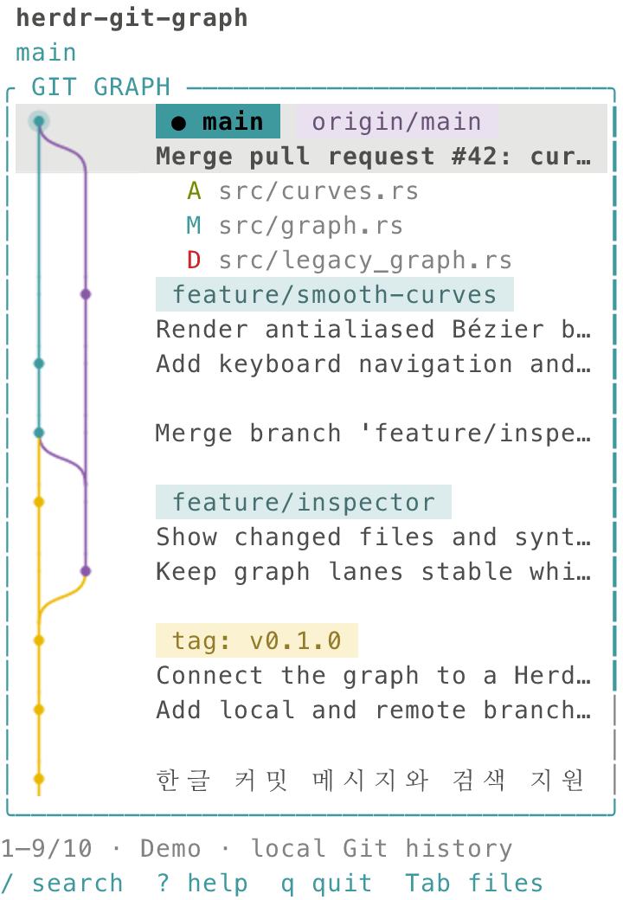
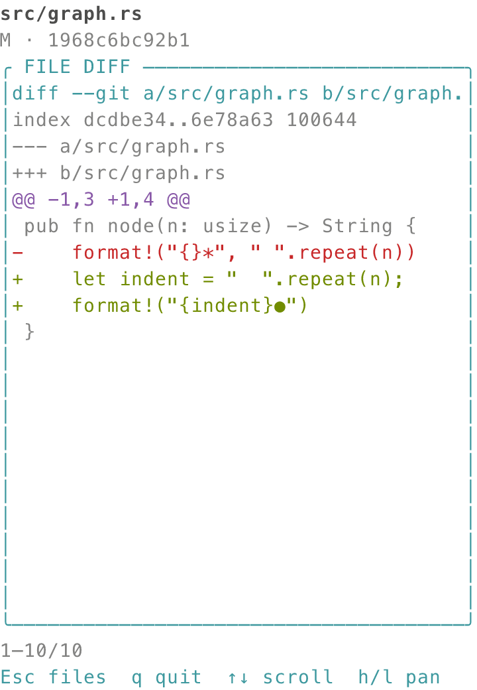

# Herdr Git Graph

**Browse Git history beside your code. Click through to file diffs.**

[](https://github.com/sjlee06/herdr-git-graph/actions/workflows/ci.yml)
[](LICENSE)
[](https://herdr.dev/docs/plugins/)

English · [한국어](README.ko.md)

A read-only Git graph plugin for Herdr. Browse history, expand a commit’s changed files, and click a file to inspect its diff inside the sidebar. Use the full view for branch filtering and complete commit diffs.

<table>
  <tr>
    <th width="50%">Dark · Classic</th>
    <th width="50%">Light · Tomorrow</th>
  </tr>
  <tr>
    <td><a href="docs/preview-sidebar-dark.png"></a></td>
    <td><a href="docs/preview-sidebar-light.png"></a></td>
  </tr>
</table>

*The default sidebar has no selected commit or highlighted row. Both images render the built-in demo history in Classic and Tomorrow colors. Click an image to enlarge it.*

[See the sidebar beside an editor in Herdr](docs/preview-sidebar.png) (demo composite). The default `--theme auto` follows your terminal's colors.

## Features

- **Workspace-shared sidebar** — one sidebar follows the active tab without taking focus, keeping its view state.
- **Branch and merge graph** — colored lanes with distinct current-branch, local-branch, remote-branch, and tag badges.
- **Changed files** — expand a commit's file statuses and paths below it without hiding the sidebar graph.
- **Diffs** — click a changed file in the sidebar to inspect its patch, or use the full view for complete commit diffs.
- **Search** — find commits by message, author, ref, or hash.
- **Live updates** — local changes appear automatically, checked every 2 seconds by default.
- **Terminal integration** — follows your terminal theme, drawing smooth curves with the standard Kitty graphics protocol in Herdr 0.9.0+ panes and using a text graph otherwise.

History puts branch and tag badges above commit subjects. The current branch is marked `●`, remote branches use purple-toned badges, and extra badges appear as `+N` when space is limited. Commit hashes are hidden from the history list; the full view's inspector shows hashes and complete ref labels. Hash search still works.

## Graphics renderer

Smooth curves are standard Kitty graphics PNGs written directly to the graph pane's PTY; no Herdr graphics socket API is used. The graph stays aligned in terminal cells, keeps text and dialogs above the curves, and removes its own image on resize, help, or exit.

Curves need Herdr 0.9.0+ with Kitty graphics enabled and a compatible outer terminal. The plugin automatically falls back to the colored Unicode graph when that path is unavailable; `--renderer text` always selects it. See the [usage guide](docs/USAGE.md#renderers) for renderer and theme options.

## Install

Requires **Herdr 0.9.0+**, **Git 2.31+**, and `curl`. **Rust and Cargo are not required.**

Prebuilt releases support **macOS 11+** and **Linux with glibc 2.35+** (for example, Ubuntu 22.04+), on Apple Silicon/ARM64 and x86_64. For other systems, see [source builds](docs/DEVELOPMENT.md).

```bash
herdr plugin install sjlee06/herdr-git-graph
```

From a Herdr workspace containing a Git repository, open the sidebar at the full-height right edge of the tab:

```bash
herdr plugin action invoke herdr.git-graph.sidebar
```

The action reuses one sidebar per workspace, keeping existing panes and their nested splits on the left. The initial repository comes from the invoking pane, independently of the sidebar’s position. If it is on another tab, it moves to the tab you invoked the action from; subsequent tab switches bring it along without taking focus. The same process keeps the selected commit, scroll position, search, and theme. Your chosen width is remembered and restored where space allows, and other workspaces have their own sidebar.

Drag the divider or use `prefix+r` to resize the sidebar. Use `prefix+l` to focus it, then `q` to close. Closing the pane also ends sharing; only another sidebar action opens it again. Closing its containing tab instead recreates the sidebar if another tab remains in the same workspace, restoring its original repository, theme, selected commit, scroll position, search, and chosen width. See the [usage guide](docs/USAGE.md#graph-only-sidebar) for sizing limits and unshared sidebar launches.

### Full view

<table>
  <tr>
    <th width="50%">Dark · Classic</th>
    <th width="50%">Light · Tomorrow</th>
  </tr>
  <tr>
    <td><a href="docs/preview.png"></a></td>
    <td><a href="docs/preview-light.png"></a></td>
  </tr>
</table>

*The same built-in demo history in the full view, with a commit selected and its inspector scrolled to a file patch.*

Open the full graph in a new tab for branch filtering and a split-panel diff inspector:

```bash
herdr plugin action invoke herdr.git-graph.open
```

### Add a keybinding

Add an available key to `~/.config/herdr/config.toml`:

```toml
[[keys.command]]
key = "prefix+u"
type = "plugin_action"
command = "herdr.git-graph.toggle-sidebar"
description = "Toggle Git Graph Sidebar"

[[keys.command]]
key = "prefix+shift+u"
type = "plugin_action"
command = "herdr.git-graph.open"
description = "Open Git Graph in New Tab"
```

Run `herdr config check`, then `herdr server reload-config`. Press your prefix followed by `Shift+u` to open the full graph in a new tab, or `u` to toggle the sidebar: open it when closed, or close it when already open. Closing this way remembers the last chosen width and stops tab-following until the next open. Reopening restores that width where space allows. The `herdr.git-graph.sidebar` action remains open-only and reuses an existing sidebar.

## Use

1. **Browse history.** The sidebar starts with no selected commit or highlighted row, as shown above. Scrolling does not select a commit.
2. **Click a commit.** Its row is highlighted and changed-file statuses and paths appear directly below it. The graph stays visible. Click the same commit again or press **Esc** to collapse the list and clear the selection.
3. **Click a file.** The sidebar shows only that file’s diff. Press **Esc** to return to the same expanded list and scroll position.

<table>
  <tr>
    <th width="50%">Click a commit → changed files</th>
    <th width="50%">Click a file → file diff</th>
  </tr>
  <tr>
    <td><a href="docs/preview-sidebar-files-light.png"></a></td>
    <td><a href="docs/preview-sidebar-diff-light.png"></a></td>
  </tr>
</table>

*Light-theme snapshots of the same built-in demo history and patch shown above. These are not live Herdr window captures. Dark versions: [changed files](docs/preview-sidebar-files-dark.png) · [file diff](docs/preview-sidebar-diff-dark.png).*

With the keyboard, **↑** / **↓** select and expand commits, and **Enter** toggles the list. Press **Tab** to focus files, select one with **↑** / **↓**, and press **Enter** to open its diff. The wheel scrolls history and long file lists without changing selection. In a diff, use the wheel or **↑** / **↓** to scroll, and **h** / **l** to pan horizontally.

In the full view, select a branch and press **Enter** to filter its history; press **a** to show all branches again. Select a commit or **Uncommitted changes** to inspect its diff below.

| Key | Action |
| --- | --- |
| `Tab` / `Shift-Tab` | Switch commit / file navigation in the sidebar; switch panels in the full view |
| `↑` `↓` / `j` `k` | Navigate commits or files, or scroll the diff |
| `Enter` | Apply search; toggle a sidebar file list or open its selected file; apply a branch filter / focus the inspector in the full view |
| `h` / `l` | Scroll diff text horizontally, or pan the graph in History |
| `Esc` | Return from a file diff to the list; collapse the sidebar list and deselect; clear search / close Help |
| `/`, then `n` / `N` | Search, then jump between matches |
| `a` | Show all branches |
| `r` | Reload the file diff or local Git history |
| `?` | Open / close Help |
| `q` / `Ctrl-C` | Quit (`q` closes Help first) |

In the full view, mouse clicks select items. The wheel scrolls the panel under the pointer. Sidebar file diffs show staged and unstaged changes separately; untracked text files show a read-only content preview.

The viewer reads local Git data. Fetch in your normal Git workflow to see new remote commits. Search covers the loaded history: **2,000 commits by default**, configurable with `--limit`.

See the [usage guide](docs/USAGE.md) for all shortcuts, repository selection, theme settings, and troubleshooting. You can also [run without Herdr](docs/USAGE.md#run-without-herdr).

## Development

See the [development guide](docs/DEVELOPMENT.md) for builds, tests, and contributing. For bug reports, include your OS, Herdr version, terminal, and steps to reproduce.

## License

[MIT](LICENSE). An independent community plugin for [Herdr](https://herdr.dev/).
